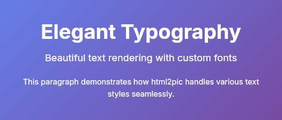
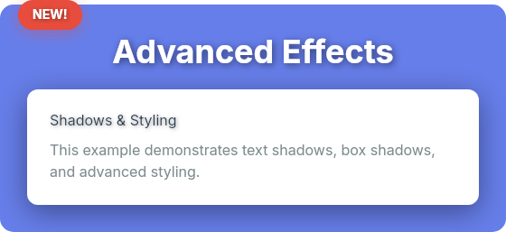
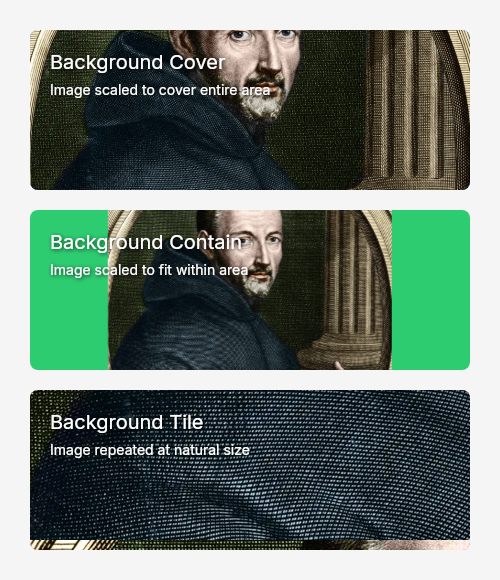

# html2pic

**Convert HTML + CSS to images — no browser required**

A Python library that transforms HTML and CSS into images.

---

## Features

- **Browser-Free Rendering** — No browser required
- **CSS Support** — Flexbox layout, gradients, shadows  and more
- **Output Formats** — PNG, JPG, and SVG (basic support for SVGs)

---

## Installation

```bash
pip install html2pic
```

---

## Quick Start

```python
from html2pic import Html2Pic

html = '''
<div class="card">
    <h1>Hello, html2pic!</h1>
    <p>Transform HTML to images with ease</p>
</div>
'''

css = '''
.card {
    display: flex;
    flex-direction: column;
    align-items: center;
    padding: 40px;
    background: linear-gradient(135deg, #667eea 0%, #764ba2 100%);
    border-radius: 20px;
    width: 400px;
}

h1 {
    color: white;
    font-size: 32px;
    font-weight: bold;
    margin: 0 0 12px 0;
}

p {
    color: rgba(255, 255, 255, 0.9);
    font-size: 18px;
    margin: 0;
}
'''

renderer = Html2Pic(html, css)
image = renderer.render()
image.save("output.png")
```

**Result:**


---

## How It Works

html2pic translates web markup into PicTex rendering instructions:

```
HTML + CSS  →  DOM Tree  →  Style Application  →  PicTex Builders  →  Image
```

1. **Parse HTML** with BeautifulSoup
2. **Parse CSS** with tinycss2
3. **Apply Styles** using CSS cascade, specificity, and inheritance
4. **Translate** styled nodes to PicTex layout primitives (Canvas, Row, Column, Text, Image)
5. **Render** using PicTex's Skia-based engine

## CSS Support

html2pic supports a comprehensive subset of modern CSS. Here's what you can use:

### Layout

| Property | Values | Notes |
|----------|--------|-------|
| `display` | `block`, `flex`, `none` | Flexbox is fully supported |
| `flex-direction` | `row`, `column`, `row-reverse`, `column-reverse` | |
| `justify-content` | `start`, `center`, `end`, `space-between`, `space-around`, `space-evenly` | |
| `align-items` | `start`, `center`, `end`, `stretch` | |
| `align-self` | Same as `align-items` | Override per-item alignment |
| `flex-grow` | Number | Control growth ratio |
| `flex-shrink` | Number | Control shrink ratio |
| `flex-wrap` | `wrap`, `wrap-reverse`, `nowrap` | Multi-line containers |
| `gap` | `px`, `%` | Spacing between flex items |

### Box Model

| Property | Values | Notes |
|----------|--------|-------|
| `width`, `height` | `px`, `%`, `auto`, `fit-content` | |
| `min-width`, `max-width` | `px`, `%` | Size constraints |
| `min-height`, `max-height` | `px`, `%` | Size constraints |
| `aspect-ratio` | Number or ratio (e.g., `16/9`) | Maintain proportions |
| `padding` | `px`, `em`, `rem` | Shorthand and individual sides |
| `margin` | `px`, `em`, `rem` | Shorthand and individual sides |
| `border` | Width, style, color | Styles: `solid`, `dashed`, `dotted` |
| `border-radius` | `px`, `%` | Shorthand or individual corners |

**Individual corner radius:**
- `border-top-left-radius`
- `border-top-right-radius`
- `border-bottom-left-radius`
- `border-bottom-right-radius`

### Visual Styling

| Property | Values | Notes |
|----------|--------|-------|
| `background` | Color and/or image | Shorthand for `background-color` + `background-image` |
| `background-color` | Hex, `rgb()`, `rgba()`, `hsl()`, `hsla()`, named | Alpha channel supported |
| `background-image` | `url()`, `linear-gradient()`, `radial-gradient()`, `conic-gradient()`, `repeating-*` | See gradients section below |
| `background-size` | `cover`, `contain`, `tile` | For images |
| `box-shadow` | `offset-x offset-y blur color` | RGBA supported |
| `overflow`, `overflow-x`, `overflow-y` | `visible`, `hidden`, `clip`, `scroll`, `auto` | Non-visible values clip to the padding box |

**Gradients:**

Linear, radial and conic gradients (and their `repeating-*` variants) follow the CSS
geometry, verified pixel by pixel against Chromium:

```css
/* Linear: angles, sides and corners */
background: linear-gradient(135deg, #667eea, #764ba2);
background: linear-gradient(to top right, red, blue);

/* Color stops: %, px, double positions, hard stops */
background: linear-gradient(90deg, #c0392b 0 33%, #ecf0f1 33% 66%, #2980b9 66%);

/* Radial: shape, size keyword or explicit size, position */
background: radial-gradient(circle closest-side at 20% 30%, white, black);
background: radial-gradient(40px 20px at right bottom, #f1c40f, transparent);

/* Conic */
background: conic-gradient(from 45deg at 30% 40%, red, yellow, lime, red);

/* Repeating */
background: repeating-linear-gradient(45deg, #333 0 8px, #eee 8px 16px);

/* A background color is painted underneath the gradient */
background: #f1c40f linear-gradient(transparent, rgba(0, 0, 255, 0.8));
```

Colors interpolate in premultiplied space like in browsers, so fading to `transparent`
doesn't go through grey. Color interpolation hints (`red, 30%, blue`) are not supported.

### Typography

| Property | Values | Notes |
|----------|--------|-------|
| `font-family` | Font names, file paths | See @font-face below |
| `font-size` | `px`, `em`, `rem` | |
| `font-weight` | `normal`, `bold`, `100-900` | |
| `font-style` | `normal`, `italic` | |
| `color` | Hex, `rgb()`, `rgba()`, `hsl()`, `hsla()`, named | Legacy and space-separated syntax |
| `text-align` | `left`, `right`, `center`, `justify` | |
| `line-height` | Number, `px`, `%`, `em`, `rem`, `normal` | |
| `text-decoration` | `underline`, `line-through` | |
| `text-shadow` | `offset-x offset-y blur color` | |

**@font-face Support:**
```css
@font-face {
    font-family: "CustomFont";
    src: url("./fonts/custom.ttf");
    font-weight: normal;
    font-style: normal;
}

@font-face {
    font-family: "CustomFont";
    src: url("./fonts/custom-bold.ttf");
    font-weight: bold;
}

h1 {
    font-family: "CustomFont", Arial, sans-serif;
    font-weight: bold;
}
```

**Features:**
- Multiple weights and styles per family
- Fallback chains (prioritizes @font-face, then system fonts)
- Relative paths (resolved against `base_url`, or the stylesheet that declares them), absolute paths, `data:` URIs and, with a `fetcher`, remote URLs

### Inline content

Text and inline elements (`<b>`, `<span>`, `<a>`, `<em>`, `<br>`, inline `::before`/`::after`,
...) flow together in lines and wrap as a paragraph, with whitespace collapsed like in
browsers. Inline elements can change typography (color, font, size, weight, style,
decoration, shadow). An inline element that needs a box of its own (background, padding,
border, size) or an image inside text is laid out in a wrapping row next to the text
instead of on the text baseline.

html2pic has no user-agent stylesheet: `<b>`, `<h1>`, etc. have no default styles, so set
them in your CSS (`b { font-weight: bold }`).

### Positioning & Transforms

| Property | Values | Notes |
|----------|--------|-------|
| `position` | `static`, `relative`, `absolute`, `fixed` | |
| `top`, `right`, `bottom`, `left` | `px`, `%`, `em`, `rem` | |
| `transform` | `translate()`, `translateX()`, `translateY()` | Only translate supported |

**Centering with transforms:**
```css
.centered {
    position: absolute;
    top: 50%;
    left: 50%;
    transform: translate(-50%, -50%);
}
```

### Selectors

- **Tag:** `div`, `p`, `h1`, etc.
- **Class:** `.my-class`
- **ID:** `#my-id`
- **Universal:** `*`
- **Compound:** `div.card`, `.btn.primary`, `h1#title`
- **Descendant:** `.card h1`
- **Child:** `ul > li`
- **Pseudo-elements:** `::before` and `::after` (also `:before`/`:after`), with `content` strings, `attr()` and quotes

Specificity follows CSS rules (IDs > classes > tags). Selectors that are not supported yet
(pseudo-classes, other pseudo-elements, attribute selectors, `+` and `~`) are skipped with a warning.

---

## Examples

Complete examples with source code are available in the [`examples/`](examples/) directory.

### Basic Card Layout

Simple flexbox card with centered content:


### User Profile Card

Social media style card with avatar and information:


### Typography Showcase

Advanced text styling and formatting:



### Visual Effects

Shadows, positioning, and advanced styling:



### Background Images

Background image support with different sizing modes:



[View all examples with source code](examples/)

---

## API Reference

### `Html2Pic(html, css="", *, base_url=None, fetcher=None)`

Main renderer class.

| Argument | Description |
|----------|-------------|
| `html` | HTML to render. `<style>` elements and `style=""` attributes are applied. |
| `css` | Extra CSS, applied after the document's own stylesheets (it wins ties). |
| `base_url` | Directory, file or URL that relative URLs (images, fonts, stylesheets) resolve against. Defaults to the current directory. A `<base href>` in the document is resolved against it. |
| `fetcher` | Callable `(url) -> bytes` that loads `<link rel="stylesheet">`, `@import` and remote images/fonts. See below. |

**Methods:**

| Method | Returns | Description |
|--------|---------|-------------|
| `render(crop_mode=CropMode.CONTENT_BOX)` | `BitmapImage` | Render to PNG/JPG |
| `render_as_svg(embed_font=True)` | `VectorImage` | Render to SVG |
| `debug_info()` | `dict` | Get parsing and styling details |

**Output Formats:**

The returned `BitmapImage` and `VectorImage` objects provide:

```python
# Save to file
image.save("output.png")

# Convert to other formats
numpy_array = image.to_numpy()
pil_image = image.to_pillow()

# Display
image.show()
```

---

### Stylesheets and external resources

CSS can come from three places, applied in this order (later wins ties; specificity and
`style=""` attributes still take precedence as in browsers):

1. `<style>` elements and `<link rel="stylesheet">` in the document, in document order
2. the `css` argument
3. `style=""` attributes

Relative URLs resolve against `base_url`, or, inside a stylesheet, against that stylesheet's
own URL. Local images and fonts are read directly, and `data:` URIs work everywhere.

**Linked stylesheets, `@import` and remote (`http(s)://`) images and fonts are only loaded
through a `fetcher`.** Without one they are skipped with a warning. This is deliberate:
html2pic is often used to render HTML coming from users, and it should never reach the
network or read files the caller did not allow.

```python
from html2pic import Html2Pic
from html2pic.fetchers import local_fetcher, http_fetcher, chain_fetchers

html = """
<link rel="stylesheet" href="css/card.css">
<link rel="stylesheet" href="https://fonts.example.com/brand.css">
<div class="card">Hello</div>
"""

fetcher = chain_fetchers(
    local_fetcher("./templates"),               # only files inside ./templates
    http_fetcher(timeout=5, max_bytes=5_000_000),
)
Html2Pic(html, base_url="./templates/", fetcher=fetcher).render().save("card.png")
```

Any callable `(url: str) -> bytes` works as a fetcher, so you can add caching, an allowlist
of hosts, authentication, etc.

---

## Limitations

html2pic supports a subset of CSS, several features are not implemented:

| Feature | Status | Alternative |
|---------|--------|-------------|
| CSS Grid | ❌ Not supported | Use Flexbox |
| Transforms (rotate, scale, skew) | ❌ Not supported | Only `translate()` works |
| Animations & Transitions | ❌ Not supported | Generate static images |
| Pseudo-classes (`:hover`, `:nth-child`), attribute selectors, `+`/`~` | ❌ Not supported | Use classes |
| Percentage `padding`, `margin`, `gap` | ❌ Not supported | Use `px`, `em` or `rem` |
| `@media` rules and media-conditional stylesheets | ❌ Skipped with a warning | — |
| Media Queries | ❌ Not supported | Set explicit dimensions |
| Inline boxes with background/padding, images inside text | ⚠️ Laid out in a row next to the text | Keep decorated inline content short |
| Mixed font sizes in one line | ⚠️ Line height doesn't grow to fit them | Set a `line-height` large enough |
| Single-axis clipping (`overflow-x: clip` + `overflow-y: visible`) | ⚠️ Clips both axes | Use `overflow: hidden` |

---

## Contributing

Contributions are welcome! Please feel free to:

- Report bugs via [GitHub Issues](https://github.com/francozanardi/html2pic/issues)
- Suggest features or improvements
- Submit pull requests

For major changes, please open an issue first to discuss your ideas.

### Running the tests

```bash
pip install -e ".[dev]"
pytest
```

Use `pytest --cov=html2pic` for a coverage report. On minimal Linux images, `skia-python`
needs the EGL/GL system libraries (`apt-get install libegl1 libgl1`).

Besides unit and integration tests, `tests/visual/` compares html2pic's output pixel by
pixel against reference screenshots taken with Chromium. Adding a rendering test is as easy
as dropping an HTML file in `tests/visual/cases/` and running
`python tools/generate_visual_references.py`; see [tests/visual/README.md](tests/visual/README.md).

---

## License

MIT License - see [LICENSE](LICENSE) file for details.

---

## Acknowledgments

Built with:
- **[PicTex](https://github.com/francozanardi/pictex)** — High-performance rendering engine (Skia + Taffy)
- **[BeautifulSoup](https://www.crummy.com/software/BeautifulSoup/)** — HTML parsing
- **[tinycss2](https://github.com/Kozea/tinycss2)** — CSS parsing

---

## Version & Status

See [CHANGELOG.md](CHANGELOG.md) for version history and migration guides.

---

## Development Status

**Note:** This software is currently in early alpha stage and may contain bugs or unexpected behavior. Use with caution in production environments and please report any issues you encounter.
